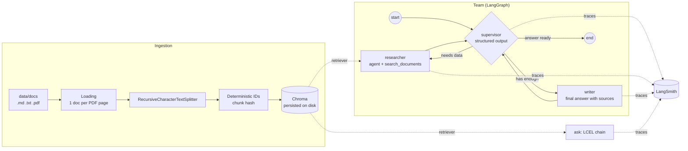

# RAG + agent team with LangChain, Chroma, LangGraph and LangSmith

[](https://github.com/AlanFMF/rag-langgraph-supervisor/actions/workflows/ci.yml)


[🇧🇷 Português](README.md) · 🇺🇸 English

An assistant that answers questions about a company's internal documents and cites the
file (and page) behind every fact. It runs in two modes:

- **`ask`, plain RAG**: an LCEL chain that retrieves chunks from Chroma and generates the answer.
- **`team`, an agent team in LangGraph**: a **supervisor** decides at each step whether
  to call the **researcher** (an agent with a document-search tool) or the **writer**
  (which drafts the final answer using only what was found).

Everything is traced in **LangSmith**, and an evaluation compares both modes on the same
question set.

> The documents in `data/docs/` belong to a **fictional** company (Aurora Entregas),
> written in Portuguese. This is on purpose: the model cannot know these rules in
> advance, so a correct answer can only come from retrieval, not from the model's memory.

## Architecture



## Design decisions

- **Incremental ingestion.** Each chunk's ID is a hash of its content and position.
  Re-running `ingest` only embeds what changed and deletes chunks from edited or removed
  files, so the collection always mirrors the folder.
- **Ingestion safeguards.** An empty folder never wipes the collection, and switching the
  embedding model without re-indexing raises a clear error (suggesting `--reset`)
  instead of failing mid-search with mismatched dimensions.
- **Traceable citations.** The search tool returns text to the model and the `Document`s
  as an *artifact*, so sources leave the graph as structured data (`sources`) instead of
  being parsed out of generated text.
- **A cheap, predictable supervisor.** It routes with structured output (`Route`, a
  Pydantic model), but anything that doesn't need an LLM is decided without one: the
  flow ends after the writer, and a step cap (`MAX_STEPS`) forces an answer if the
  supervisor keeps asking for research. Infinite loops are impossible.
- **Clean context between agents.** The researcher's tool calls stay inside it; only its
  final notes reach the rest of the team, which saves tokens and keeps traces readable.
- **Provider set in `.env`.** `init_chat_model` / `init_embeddings` take
  `provider:model`: OpenAI, Gemini (free tier), Anthropic or Ollama (local).
- **Network-free tests.** A scripted chat model plays each agent in the tests and
  deterministic embeddings make Chroma work without an API. CI needs no keys.

## Running it

Requirements: Python 3.10+, an API key for an LLM provider and (for tracing) a free
[LangSmith](https://smith.langchain.com) account.

```bash
git clone https://github.com/AlanFMF/rag-langgraph-supervisor.git
cd rag-langgraph-supervisor
python -m venv .venv && source .venv/bin/activate   # Windows: .venv\Scripts\Activate.ps1
pip install -e ".[dev]"
cp .env.example .env                                  # then fill in your keys

ragagents ingest
ragagents ask "Qual o limite de hospedagem em capitais?"
ragagents team -v "Posso pedir reembolso de bebida no jantar? E qual o limite diário de alimentação?"
ragagents graph
```

Questions can be asked in English too; answers follow the language of the question.
To use your own documents, drop `.md`, `.txt` or `.pdf` files into `data/docs/` (or set
`DOCS_DIR`) and run `ragagents ingest` again. After changing the embedding model, run
`ragagents ingest --reset`.

## LangSmith

**Tracing.** With `LANGSMITH_TRACING=true` and `LANGSMITH_API_KEY` set, every run becomes a
trace in `LANGSMITH_PROJECT`, showing the full tree: supervisor → researcher agent → tool
calls → retriever → LLM. Runs carry `ask`/`team` tags and `chat_model`, `embedding_model`,
`top_k` and `chunk_size` metadata so configurations can be filtered and compared.
Ingestion shows up as its own `ingest` run.

**Evaluation.** `data/eval/qa.json` holds 9 questions with expected answer and source,
including a multi-part question and one whose answer is *not* in the documents.

```bash
ragagents eval --target chain
ragagents eval --target team
```

The dataset is created in LangSmith on the first run. Each command logs an experiment with
`source_hit` (was the expected document retrieved?) and `correctness` (LLM-as-judge against
the reference). Compare both experiments side by side under *Datasets & Experiments*.

> On free tiers (such as Gemini's), set `LLM_REQUESTS_PER_MINUTE` in `.env`. A single rate
> limiter shared by the agents and the judge spaces out calls so the evaluation doesn't
> fail with 429 errors.

## Results

Evaluation logged in LangSmith on 2026-11-14, using `gemini-3.5-flash-lite` (answers and
judge) and `gemini-embedding-001` (retrieval):

| Mode | correctness | source_hit | Errors |
|---|---|---|---|
| `chain` (plain RAG) | 9/9 (1.00) | 8/8 (1.00) | 0% |
| `team` (supervisor + 2 agents) | 9/9 (1.00) | 8/8 (1.00) | 0% |

`source_hit` covers 8 questions because one question deliberately has no answer in the
documents; both modes correctly said the information was not found.

**How to read these numbers:**

- **On this set, both modes tie.** The team brings no accuracy gain and makes several model
  calls per question (supervisor, researcher and writer) versus one for plain RAG. For direct
  questions like these, plain RAG is the cheaper choice.
- **The team's expected advantage is on multi-part questions**, where the supervisor asks for
  a second research round (visible in the traces). Measuring that gain requires a harder
  question set, which is the next step.
- **9 questions is a sanity check, not a benchmark.** The judge is the same model that
  answers, which may make scores generous.
- **Experiment latencies are omitted** because they include the rate limiter's waiting time
  (free tier) and do not reflect real speed.

## LangGraph Studio (optional)

```bash
pip install -e ".[studio]"
langgraph dev
```

## Tests

```bash
pytest          # 22 tests, no network, no API keys
ruff check .
```

## Limitations and next steps

- Retrieval is vector-only; hybrid search (BM25 + vectors) with reranking should help with
  exact terms such as acronyms and amounts.
- The writer trusts the researcher's notes; a verification step that checks each sentence
  against a retrieved chunk would further reduce hallucination risk.
- A web UI (Streamlit or a FastAPI endpoint) would make demos easier.

## License

MIT. See [LICENSE](LICENSE).
