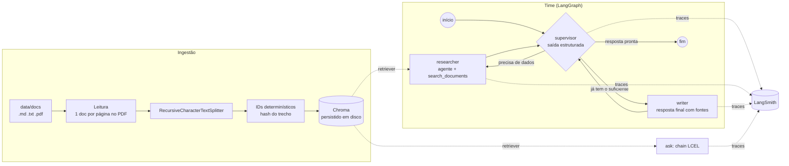

# RAG + time de agentes com LangChain, Chroma, LangGraph e LangSmith

[](https://github.com/AlanFMF/rag-langgraph-supervisor/actions/workflows/ci.yml)


🇧🇷 Português · [🇺🇸 English](README.en.md)

Assistente que responde perguntas sobre documentos internos de uma empresa, sempre
citando de qual arquivo (e página) veio cada informação. Ele funciona de dois jeitos:

- **`ask`, o RAG simples**: uma chain LCEL que busca os trechos no Chroma e gera a resposta.
- **`team`, um time de agentes no LangGraph**: um **supervisor** decide, a cada passo,
  se chama o **pesquisador** (agente com ferramenta de busca nos documentos) ou o
  **redator** (que escreve a resposta final só com o que foi encontrado).

Tudo é rastreado no **LangSmith**, e há uma avaliação que compara os dois modos no
mesmo conjunto de perguntas.

> Os documentos em `data/docs/` são de uma empresa **fictícia** (Aurora Entregas).
> Fiz assim de propósito: como o modelo não tem como saber essas regras de antemão,
> uma resposta certa só pode ter vindo da recuperação, não da memória do modelo.

## Arquitetura



## Decisões técnicas

- **Ingestão incremental.** Cada trecho ganha um ID que é o hash do conteúdo + posição.
  Rodar `ingest` de novo só gera embeddings do que mudou, e apaga os trechos de
  arquivos editados ou removidos. A coleção sempre espelha a pasta.
- **Proteções na ingestão.** Uma pasta vazia não apaga a coleção, e trocar o modelo de
  embeddings sem reindexar gera um erro claro (com a dica do `--reset`) em vez de
  falhar no meio da busca com dimensões incompatíveis.
- **Citações rastreáveis.** A ferramenta de busca devolve texto para o modelo e os
  `Document`s como *artifact*. Assim as fontes saem estruturadas do grafo (`sources`),
  sem precisar extrair do texto gerado.
- **Supervisor barato e previsível.** Ele roteia com saída estruturada (`Route`, um
  modelo Pydantic), mas o que dá para decidir sem LLM é decidido sem LLM: depois do
  redator o fluxo termina, e um teto de passos (`MAX_STEPS`) força a resposta se o
  supervisor insistir em pesquisar. Não existe laço infinito.
- **Contexto limpo entre agentes.** As chamadas de ferramenta do pesquisador ficam
  dentro dele. Para o resto do time só vão as notas finais, o que economiza tokens
  e deixa o trace mais legível.
- **Provedor trocável pelo `.env`.** `init_chat_model` / `init_embeddings` aceitam
  `provedor:modelo`: OpenAI, Gemini (tem cota gratuita), Anthropic ou Ollama (local).
- **Testes sem rede.** Um modelo de chat "roteirizado" faz o papel de cada agente nos
  testes, e embeddings determinísticos fazem o Chroma funcionar sem API. O CI roda sem
  nenhuma chave.

## Como rodar

Pré-requisitos: Python 3.10+, uma chave de API de um provedor de LLM e (para o
rastreamento) uma conta gratuita no [LangSmith](https://smith.langchain.com).

**Windows (PowerShell)**

```powershell
git clone https://github.com/AlanFMF/rag-langgraph-supervisor.git
cd rag-langgraph-supervisor
python -m venv .venv
.venv\Scripts\Activate.ps1
pip install -e ".[dev]"
copy .env.example .env   # depois abra o .env e preencha as chaves
```

**Linux / macOS**

```bash
git clone https://github.com/AlanFMF/rag-langgraph-supervisor.git
cd rag-langgraph-supervisor
python -m venv .venv && source .venv/bin/activate
pip install -e ".[dev]"
cp .env.example .env     # depois preencha as chaves
```

Depois:

```bash
ragagents ingest                 # indexa data/docs no Chroma (.chroma/)
ragagents ask "Qual o limite de hospedagem em capitais?"
ragagents team -v "Posso pedir reembolso de bebida no jantar? E qual o limite diário de alimentação?"
ragagents graph                  # imprime o diagrama do grafo em Mermaid
```

Com `-v`, o comando `team` mostra cada decisão do supervisor e o motivo dela.
Para usar seus próprios documentos, coloque arquivos `.md`, `.txt` ou `.pdf` em
`data/docs/` (ou aponte `DOCS_DIR`) e rode `ragagents ingest` de novo.

> Quer usar outro provedor? Instale o extra (`pip install -e ".[google]"`,
> `".[ollama]"` ou `".[anthropic]"`) e ajuste `CHAT_MODEL` / `EMBEDDING_MODEL` no `.env`.
> Ao trocar o modelo de embeddings, rode `ragagents ingest --reset`.

## LangSmith

**Rastreamento.** Com `LANGSMITH_TRACING=true` e `LANGSMITH_API_KEY` no `.env`, cada
execução vira um trace no projeto `LANGSMITH_PROJECT`, com a árvore completa:
supervisor → agente pesquisador → chamadas da ferramenta → retriever → LLM. Os runs
recebem as tags `ask`/`team` e os metadados `chat_model`, `embedding_model`, `top_k` e
`chunk_size`, o que permite filtrar e comparar configurações. A ingestão também
aparece como um run próprio (`ingest`).

**Avaliação.** `data/eval/qa.json` tem 9 perguntas com resposta e fonte esperadas
(incluindo uma com várias partes e uma cuja resposta *não* está nos documentos).

```bash
ragagents eval --target chain   # RAG simples
ragagents eval --target team    # time de agentes
```

Na primeira execução o dataset é criado no LangSmith. Cada comando registra um
experimento com duas métricas:

- `source_hit`: o documento esperado estava entre as fontes recuperadas?
- `correctness`: um LLM-juiz compara a resposta com a referência.

Os dois experimentos podem ser comparados lado a lado na aba *Datasets & Experiments*.

## LangGraph Studio (opcional)

```bash
pip install -e ".[studio]"
langgraph dev
```

O Studio abre o grafo `rag_team` (definido em `langgraph.json`) para você conversar
com o time e ver o estado passo a passo.

## Testes

```bash
pytest          # 19 testes, sem rede e sem chaves de API
ruff check .
```

Os testes cobrem: leitura de Markdown e PDF com página na citação, idempotência e
sincronização da ingestão, proteção contra pasta vazia, detecção de troca de embeddings,
recuperação do documento certo, prompt do RAG com contexto, o fluxo
supervisor → pesquisador → redator, o atalho direto para o redator, o limite de passos,
e as métricas da avaliação.

## Estrutura

```
src/ragagents/
├── config.py       # Settings lidas do .env, com validação
├── models.py       # init_chat_model / init_embeddings + checagem de chaves
├── offline.py      # embeddings determinísticos (testes e CI)
├── ingest.py       # leitura, divisão em trechos e sincronização com o Chroma
├── vectorstore.py  # Chroma persistente, retriever e formatação com citações
├── rag_chain.py    # RAG simples em LCEL
├── prompts.py      # prompts do RAG e dos agentes
├── agents.py       # estado do time, supervisor, pesquisador e redator
├── graph.py        # montagem do StateGraph
├── evaluation.py   # dataset e avaliadores no LangSmith
├── tracing.py      # nomes, tags e metadados dos traces
├── studio.py       # entrada para o LangGraph Studio
└── cli.py          # comandos ingest / ask / team / graph / eval
data/docs/          # documentos fictícios (3 .md + 1 .pdf)
data/eval/qa.json   # perguntas da avaliação
tests/              # pytest com modelo roteirizado
```

## Limitações e próximos passos

- A busca é só vetorial. Uma busca híbrida (BM25 + vetores) com *reranking* deve
  ajudar em perguntas com termos exatos, como siglas e valores.
- O redator confia nas notas do pesquisador. Um passo de verificação (checar se cada
  frase da resposta está apoiada em algum trecho) reduziria o risco de alucinação.
- Uma interface web (Streamlit ou uma API FastAPI) facilitaria a demonstração.

## Licença

MIT. Veja [LICENSE](LICENSE).
